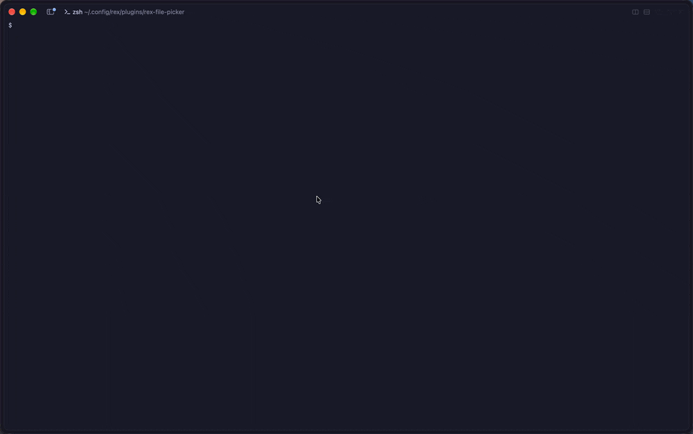

# rex-file-picker

[](https://github.com/daehyeok/rex-file-picker/actions/workflows/test.yml)

Fuzzy-pick files in a [Rex](https://www.superlogical.com/rex) terminal pane with [fzf](https://github.com/junegunn/fzf), from the pane's directory and any other folders you choose, preview them, and insert or copy their paths, in local panes and panes on remote Rex hosts alike. Inspired by [tmux-file-picker](https://github.com/raine/tmux-file-picker).



## Features

- **fzf search** over the files under the focused pane's directory, a git root, your notes, or any folder a command or a Lua function finds.
- **Each file once:** when folders overlap, a file is listed under the first folder in your list.
- **Insert or copy:** `enter` types the selected paths into your pane (shell-quoted, nothing runs), and `ctrl-y` copies them to your Mac's clipboard. `alt-A`/`alt-R` and `alt-a`/`alt-r` do the same with absolute or pane-relative paths. Mark several files with `tab`.
- **Relative or absolute paths, per folder:** relative for the pane's directory and absolute for other folders by default.
- **Previews by file type**, run on the pane's host: [mdcat](https://github.com/swsnr/mdcat) or [glow](https://github.com/charmbracelet/glow) for Markdown, [bat](https://github.com/sharkdp/bat) (or `cat`) for text, `kitten icat` for images, `tree` (or `ls`) for folders. You can add or replace rules.
- **Zoxide and directories:** pick from [zoxide](https://github.com/ajeetdsouza/zoxide)'s frecent directories, or switch the list to folders only.
- **Arrow and Emacs keys:** `up`/`ctrl-p`, `down`/`ctrl-n`, `page-down`/`ctrl-v`, `page-up`/`alt-v`, `esc`/`ctrl-g`. Every key can be changed.
- **Remote panes:** panes on a remote Rex host (`rex hosts add` / `rex.host`, over SSH, Tailscale, etc.) run the picker and its CLI tools (`fzf`, `fd`, previewers, `zoxide`) directly on that host, with no plugin files to install there.

## Requirements

- On the host each pane runs on:
  - `sh`, `awk`, `sed` and [fzf](https://github.com/junegunn/fzf) 0.38+ (for `become`; tested with 0.75), on the `PATH` your terminals have there: the picker starts through your shell and reads its startup files, `~/.zshrc` included (see [`interactive_shell`](#configuration)).
  - [fd](https://github.com/sharkdp/fd) (recommended; `fdfind` works too). Without it the picker uses `find`, which can't read `.gitignore` files: it lists ignored files, and leaves out only `.git` and hidden names.
  - Optional, for previews and modes: `bat` (or `batcat`), `mdcat`, `glow`, `kitten` (from [kitty](https://sw.kovidgoyal.net/kitty/)), `tree`, `file`, `zoxide`.
- The Rex app as your client. Copy uses OSC 52, which Rex passes to the Mac clipboard, so it works the same from remote panes.

## Quick start

1. Clone the plugin into your Rex config:

   ```sh
   git clone https://github.com/daehyeok/rex-file-picker ~/.config/rex/plugins/rex-file-picker
   ```

2. Set it up and bind keys in `~/.config/rex/init.lua`. The plugin binds no keys itself; this example puts them in an `f` group after `ctrl+b`:

   ```lua
   require("plugins.rex-file-picker").setup({
     roots = {
       { kind = "pwd" },
       { label = "git", cmd = "git rev-parse --show-toplevel" },
     },
     profiles = { dirs = { mode = "dirs" } },
   })

   local prefix = "ctrl+b" -- the key that starts the group; use your own if you have one
   rex.bind(prefix .. ">f>f", "pick_file") -- files
   rex.bind(prefix .. ">f>z", "pick_zoxide_dir") -- zoxide directories
   rex.bind(prefix .. ">f>d", "pick_file_dirs") -- directories only
   ```

3. Reload: `rex config reload`.

Then, in any pane, press `ctrl+b`, then `f`, then `f` to pick files (`ctrl+b f z` for zoxide directories, `ctrl+b f d` for directories only).

The actions are also in the command palette ("Pick a File", "Pick a Zoxide Directory", and one per profile). They work on the focused pane.

### With Amber

Instead of cloning, you can install the plugin with [Amber](https://github.com/rawnly/amber), which must be installed first. In `~/.config/rex/init.lua`:

```lua
local amber = dofile(os.getenv("HOME") .. "/.local/share/rex/amber/amber.lua")

amber.setup({
  plugins = {
    {
      "daehyeok/rex-file-picker",
      main = "file_picker",
      opts = {
        roots = {
          { kind = "pwd" },
          { label = "git", cmd = "git rev-parse --show-toplevel" },
        },
        profiles = { dirs = { mode = "dirs" } },
      },
    },
  },
})
```

Then run `amber install`. It installs the plugin and reloads Rex; loading the config alone never installs. Bind the keys as in step 2.

## Keys

| Key | Does |
|---|---|
| type | filter the list (fuzzy) |
| `up` / `down`, `ctrl-p` / `ctrl-n` | move |
| `page-up` / `page-down`, `alt-v` / `ctrl-v` | move by a screenful |
| `home` / `end`, `alt-<` / `alt->` | first / last row |
| `tab` / `shift-tab` | mark / unmark (fzf's own) |
| `enter` | insert the marked paths (or the highlighted one) into the pane |
| `ctrl-y` | copy them to the clipboard |
| `alt-A` / `alt-R` | insert them as absolute paths / as paths relative to the pane's directory |
| `alt-a` / `alt-r` | copy them as absolute paths / as paths relative to the pane's directory |
| `ctrl-t` | switch between files and directories |
| `ctrl-z` | switch to zoxide's directories and back (when zoxide is installed) |
| `ctrl-/` | hide or show the preview |
| `esc`, `ctrl-g` | close |

fzf's own line editing (`ctrl-a`, `ctrl-e`, `ctrl-b`, `ctrl-f`, `ctrl-d`, `ctrl-k`, `ctrl-w`, ...) still works in the search box. To change keys, see [`keys`](#keys-1).

## Configuration

Every option is optional. An unknown or misspelled option, root field, preview field or key action raises an error that names it, and `rex config check` reports it.

| Option | Default | What it does |
|---|---|---|
| [`roots`](#roots) | `{ { kind = "pwd" } }` | the folders to search, in order |
| `mode` | `"files"` | what `pick_file` lists first: `"files"` or `"dirs"` |
| [`path_style`](#path_style) | pwd relative, others absolute | how inserted and copied paths are written |
| `hidden` | `false` | list hidden files (`.git` stays out) |
| `ignore` | `true` | honor `.gitignore` and other ignore files (fd only) |
| `exclude` | `{}` | glob patterns to leave out (with `find`: matched on the name) |
| [`preview`](#preview) | see below | preview rules, replacing the defaults |
| [`preview_extra`](#preview) | `{}` | preview rules checked before the defaults |
| `preview_window` | `"right,55%"` | fzf's `--preview-window` |
| [`keys`](#keys-1) | see [Keys](#keys) | picker keys |
| `copy_cmd` | none (OSC 52) | a shell command, run on the pane's host, that gets the text on stdin |
| `fzf_options` | `""` | extra fzf flags |
| `pane_bounds` | `{ 0.05, 0.06, 0.9, 0.88 }` | the picker's position and size, as fractions of the window |
| `interactive_shell` | `true` | start the picker with your shell's interactive startup files (e.g. `~/.zshrc`), so it finds tools on the same `PATH` as your terminals; `false` uses only the login environment (`~/.zprofile`, ...) and starts a little faster |
| `title` | `"Pick a File"` | the `pick_file` title in the command palette |
| [`profiles`](#profiles) | `{}` | named settings, each its own action |

### `roots`

A list of folders, searched in order. Each entry is one of:

| Entry | Means |
|---|---|
| `{ kind = "pwd" }` | the working directory of the program in the pane (the shell, or e.g. an editor or agent running in it) |
| `{ path = "~/notes" }` | a fixed folder; `~` is expanded on the pane's host, and relative paths are relative to the pane's directory |
| `{ path = function(ctx) ... end }` | a Lua function that returns a path, a list of paths, or `nil` to skip |
| `{ cmd = "..." }` | a shell command, run on the pane's host in the pane's directory, that prints one folder per line |
| `{ cmd = function(ctx) ... end }` | a Lua function that returns such a command, or `nil` to skip |

Every entry can also set `label` (shown before its rows; default: the folder's name), `path_style`, `hidden`, `ignore` and `exclude`. A root whose folder doesn't exist, whose command prints no existing folder (its exit status doesn't matter), or whose function returns `nil` is left out. Leave out `{ kind = "pwd" }` to search only other folders.

> [!NOTE]
> Lua functions run in `init.lua` on your local Rex server (the machine with `~/.config/rex/init.lua`), so they can't look at a remote host's files. Use them to choose by host or to build a path from the pane's directory. To find a folder by looking at the disk, use `cmd`, which runs on the pane's host.

`ctx` holds `host` (the pane's server label, or `"local"`), `server`, `pwd`, `session_id` and `block_id`.

```lua
roots = {
  { kind = "pwd" },
  -- the repository root, when the pane is in a git repository
  { label = "git", cmd = "git rev-parse --show-toplevel" },
  -- a folder that exists only on one host
  { label = "data", path = function(ctx)
      if ctx.host == "devbox" then return "/srv/data" end
    end },
  -- folders a script of yours finds, e.g. an app's output folders
  { label = "out", cmd = "my-output-dirs", exclude = { "*.log" } },
}
```

### `path_style`

`"relative"` paths are relative to the pane's directory (with `../` when needed); `"absolute"` paths are full. The top-level option sets the defaults, and a root's own `path_style` wins:

```lua
path_style = { pwd = "relative", other = "absolute", zoxide = "absolute" } -- the defaults
```

### `preview`

A list of rules. The first rule that matches the highlighted entry is used, and in it the first command whose first word is installed runs, on the pane's host, with the entry's path as `$1` (`FZF_PREVIEW_COLUMNS` and `FZF_PREVIEW_LINES` are set). If none is installed, the preview is empty.

`match` is one pattern or a list of them:

- `"directory"` matches folders;
- `"mime:image/*"` matches the type `file --mime-type` reports;
- a glob with a `/`, like `"docs/*.txt"`, matches the end of the path;
- any other glob, like `"*.md"`, matches the file name.

The defaults:

| Match | Commands, in order |
|---|---|
| `directory` | `tree -C -L 2`, `ls -la` |
| `*.md`, `*.markdown` | `mdcat --ansi --image-protocol kitty` (colours and inline images even though the preview isn't a terminal; plain `--ansi` on mdcat versions without `--image-protocol`), `glow`, `bat`, `batcat`, `cat` |
| `mime:image/*`, `*.png`, `*.jpg`, `*.jpeg`, `*.gif`, `*.webp`, `*.bmp` | `kitten icat` |
| `*` | `bat`, `batcat`, `cat` |

Add rules ahead of the defaults with `preview_extra`, or replace all of them with `preview`:

```lua
preview_extra = {
  { match = "*.json", cmd = { 'jq -C . "$1"', 'cat "$1"' } },
}
```

### `keys`

Maps a picker action to a key or a list of keys, in fzf's key syntax. Setting an action replaces its default keys; other actions keep theirs.

Actions: `insert`, `copy`, `insert_absolute`, `insert_relative`, `copy_absolute`, `copy_relative`, `close`, `up`, `down`, `page_up`, `page_down`, `first`, `last`, `toggle_dirs`, `toggle_zoxide`, `toggle_preview`.

```lua
keys = {
  insert = { "enter", "ctrl-j" },
  copy = "alt-c",
  toggle_dirs = "alt-d",
}
```

### `profiles`

Each profile is a name and settings that override the top-level ones (`roots`, `mode`, `keys`, `preview`, ... ; `keys` and `path_style` merge field by field). Each becomes an action named `pick_file_<name>`, which you bind like the others.

```lua
profiles = {
  dirs = { mode = "dirs" },                                     -- pick_file_dirs
  notes = { roots = { { path = "~/notes" } }, title = "Notes" }, -- pick_file_notes
}
```

## How it works

The action runs in `init.lua` on your local Rex server (the machine with `~/.config/rex/init.lua`). It asks Rex for the pane's working directory, works out the roots (calling any Lua functions locally), and opens a floating pane over yours on the Rex server that owns your pane — local, or a remote host added with `rex hosts add` / `rex.host` (plain `ssh` inside a local shell pane stays on the local server). That pane runs the picker script under `/bin/sh` on the pane's host; the script and its helpers travel as arguments, so no plugin files have to be installed there, while `fzf`, listing, previews and `zoxide` all run on that host. When you pick, the script types the paths into your pane with the host's `rex send` or copies them with OSC 52, the Rex app renders kitty images and applies OSC 52 to your clipboard, and focus returns to your pane when the picker closes. Nothing keeps running while the picker is closed.

See [docs/design.md](docs/design.md) for more.

## Limits

- Hidden files and ignore files follow fd's defaults. With `find`, ignore files aren't read.
- The image preview needs `kitten` on the pane's host, and a client that shows kitty graphics (the Rex app does).
- Images inside Markdown previews can overlap the text below them. mdcat's image output doesn't say how tall an image is, so fzf can't leave room for it in the preview (in a plain terminal, mdcat's images are laid out fine). Image files themselves preview cleanly through `kitten icat`. For a clean text-only Markdown preview, override the rule:

  ```lua
  preview_extra = { { match = { "*.md", "*.markdown" }, cmd = 'mdcat --ansi --columns "$FZF_PREVIEW_COLUMNS" "$1"' } },
  ```
- Paths with tabs or newlines in their names are left out of the list.
- Copy goes through OSC 52, which the Rex app applies while it is the active app (as it is when you press the key). Set `copy_cmd` to use another tool.

## Development

```sh
sh tests/run_all.sh      # all tests: lua if installed (Lua 5.1 or LuaJIT), else `rex do`; then the shell tests
pre-commit install       # optional: lint and test on every commit
```

Each test finds the plugin relative to its own path and exits non-zero when a check fails. The [pre-commit](https://pre-commit.com) hooks check whitespace and YAML, run shellcheck and the [StyLua](https://github.com/JohnnyMorganz/StyLua) format check (`stylua --check .`; fix with `stylua .`) when they're installed, and run the tests. CI runs the Lua tests on Lua 5.1 and LuaJIT, the shell tests with fd and with find, on Ubuntu and macOS, and the same hooks with both tools required.

## License

[MIT](LICENSE)
